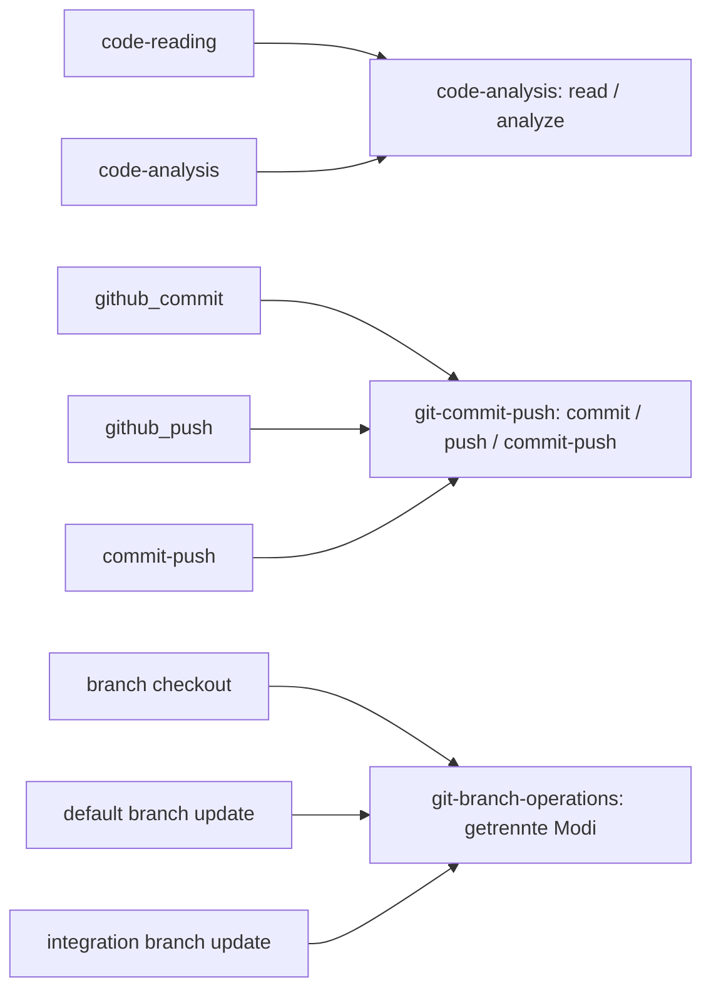
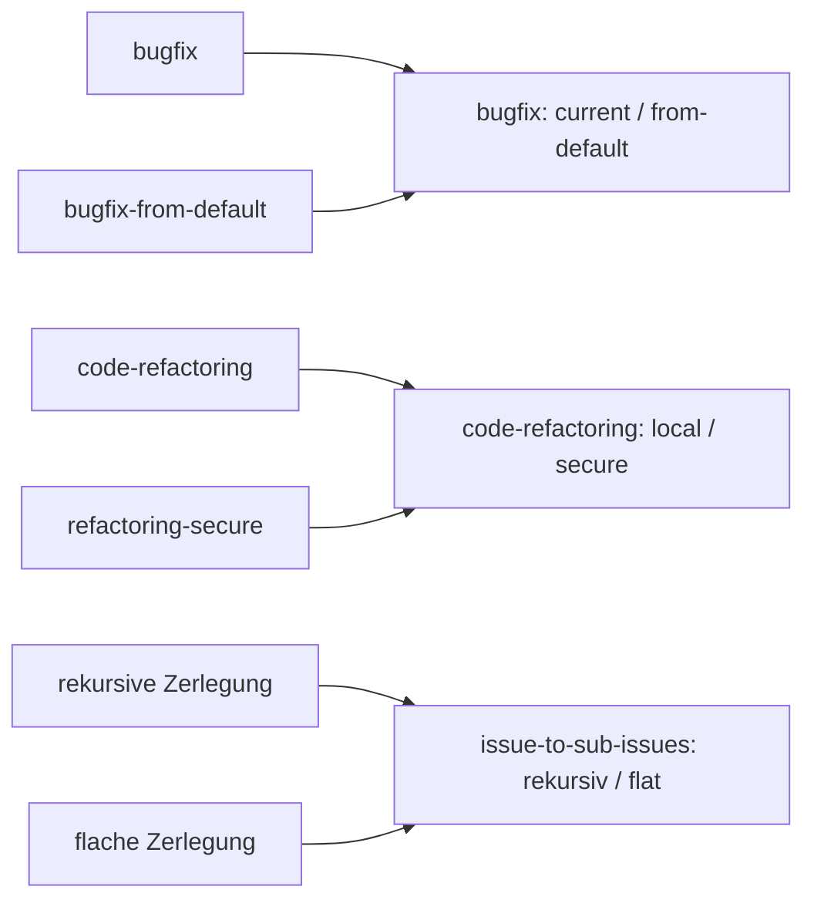
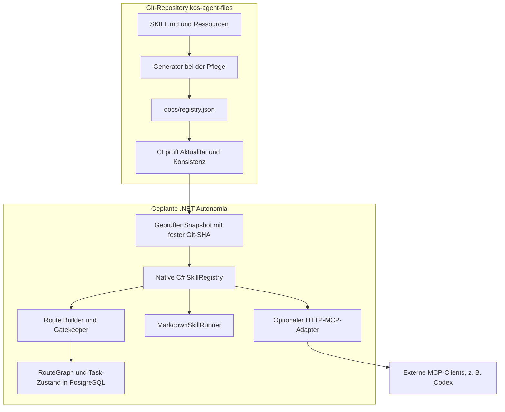

# Skill-Bibliothek: Änderungen, Begründung und Autonomia-Architektur

Stand: 6. November 2026. Präsentationsunterlage zum lokalen Refactoring in
`refactor/skill-registry`. Implementierte Bibliotheksänderungen und geplante
Autonomia-Komponenten werden ausdrücklich unterschieden.

## 1. Ausgangslage und Ergebnis

| | Ausgangslage | Aktueller Stand |
|---|---|---|
| Heljens-Verfahren | 28 Skills und 19 Workflows | Zusammengeführt und einheitlich beschrieben |
| Persönliche Skills | 9 aus zwei lokalen Quellen | Alle integriert |
| Gesamtzahl | 56 ursprüngliche Verfahren | 41 kanonische Skills: 23 Capabilities, 18 Workflows |
| Metadaten | In der alten Bibliothek keine YAML-Header | Alle 41 Entry-Points mit Art, Version und mehreren Phasen |
| Einstieg | Getrennte, umfangreiche Lookup-Dateien | Gemeinsamer Katalog; Details nach Bedarf |

Eine Capability liefert eine abgegrenzte Fähigkeit oder getrennt auswählbare
Operationen. Ein Workflow koordiniert einen Ablauf. Das gemeinsame Dateiformat
hebt diese fachliche Unterscheidung nicht auf.

```text
Vorher: docs/skills/code-analysis.md
        docs/workflows/bugfix.md

Heute:  docs/skills/code-analysis/SKILL.md
        docs/skills/code-analysis/references/...
        docs/skills/bugfix/SKILL.md
        docs/registry.json
```

47 bisherige Pfade bleiben kurze Markdown-Verweise mit dem passenden Nachfolger
und Modus. Es sind keine HTTP-Weiterleitungen. Sie werden erst mit Publikation
dieser Version erreichbar; bestehende Upstream-Links wechseln nicht automatisch
zum Fork. Die alten persönlichen Eingangskopien im Workspace unter `skills/`
sind keine zweite aktive Bibliothek. Gepflegt wird `kos-agent-files/docs/skills/`.

## 2. Zusammenführungen



| Bisher | Heute | Grund und erhaltene Grenze |
|---|---|---|
| `code-reading` + `code-analysis` | `code-analysis` | Kontextlesen und Bewertung teilen Quellen; `read` verlangt keine Bewertung. |
| Commit + Push + Commit-Push-Workflow | `git-commit-push` | Gemeinsame Git-Prüfungen; `push` erzeugt keinen Commit und `commit` keinen automatischen Push. |
| Branch-Erstellung + zwei Branch-Updates | `git-branch-operations` | Gemeinsame Status-/Fast-Forward-Prüfung; Erstellen und Zielbranch aktualisieren bleiben getrennte Operationen. |
| Issue lesen/erstellen/typisieren/verknüpfen | `github-issue-ops` | Ein Einstieg mit bedarfsweise geladenen Detailverfahren. Lesen verändert kein Issue. |
| PR erstellen/Checks beobachten/mergen | `github-pr-ops` | Gemeinsame PR-Identität; die Modi haben unterschiedliche Berechtigungen. |
| `bugfix` + `bugfix-from-default` | `bugfix` | Gleiche Diagnose und Absicherung; nur `from-default` organisiert neuen Branch und PR. |
| Refactoring + Secure-Workflow | `code-refactoring` | Gemeinsamer Verhaltenserhalt; nur `secure` ergänzt den Branch-/PR-Zyklus. |
| Historie lesen + zusammenfassen | `commit-history-summary` | Dieselben Quelldaten; `read` bleibt als reine Datenerfassung erhalten. |
| Rekursive + flache Issue-Zerlegung | `issue-to-sub-issues` | `flat` führt genau einen Zerlegungsschritt aus. |
| Erkenntnis + Instruction-Verbesserung als Issue | `insight-to-issue` | Regelverbesserungen sind ein Modus mit ausdrücklich bestimmtem Bibliotheksrepository. |



Damit entfallen 15 eigene Einstiegspunkte. Erhalten bleiben unter anderem:
`issue-implementation` für eine Arbeitseinheit, `issue-graph-implementation` für
den Gesamtgraphen und `issue-to-pr` für bereits implementierte Änderungen.
Ein technischer Diff-Review und ein menschlicher Änderungsleitfaden bleiben
ebenfalls getrennt: Fehlerbewertung und Erklärung haben unterschiedliche Ergebnisse.

## 3. Warum extreme Atomarität nicht immer hilft

Die frühere Trennung hatte einen sinnvollen Zweck: klare Verantwortungen und
kleine, kombinierbare Verfahren. Eigenständige Ergebnisse sowie besonders
unterschiedliche Nebenwirkungen rechtfertigen weiterhin getrennte Operationen.
Ein Issue zu lesen ist etwas anderes, als seinen Type oder Status zu ändern.

Die Trennung wird teuer, wenn schon ein einzelner notwendiger Lesezugriff eine
weitere Skill-Auswahl und Übergabe erzwingt. Beispiel: Der Planner muss die
Signatur eines vorhandenen API-Endpunkts kennen. Früher durfte er fehlende
Quellen nicht selbst lesen und musste vorgeschalteten Kontext anfordern.
Jetzt darf er den betroffenen Endpunkt lesen und seinen Plan darauf aufbauen.

Jede zusätzliche Übergabe braucht Ziel, Scope, Kontext und Rückgabe. Dabei kann
relevanter Kontext verloren gehen; weitere Instruktionen und Tool-Aufrufe kosten
Zeit und Kontextbudget. Ein solcher Schritt lohnt sich, wenn er eigenständige
Arbeit, Spezialisierung oder unabhängige Prüfung liefert. Für wenige Zeilen
Kontext ist dieser Nutzen oft nicht vorhanden.

Die neue Grenze richtet sich daher nach **Ergebnis, Scope und Nebenwirkungen**:
gezieltes Lesen für den eigenen Auftrag ist erlaubt. Eine Planungsfähigkeit
implementiert dadurch noch keinen Code; ein Dokumentationsauftrag erstellt
dadurch noch kein Issue. Einfache lokale Prüfungen dürfen direkt erfolgen;
risikoreiche oder umfangreiche Verifikation kann weiterhin unabhängig delegiert werden.

Für SkillRegistry und MCP bedeutet das: weniger verpflichtende Zwischenaufrufe,
verständlichere Fähigkeiten und Details, die erst bei Bedarf geladen werden.
Der Preis ist ein genauerer Vertrag pro Fähigkeit: erlaubte Operationen,
erforderliche Inputs, Ergebnis und Grenzen müssen klar bleiben. Weniger Dateien
allein beweisen keine bessere Ausführung. Zeit- und Tokengewinne wurden noch
nicht an repräsentativen Arbeitsaufgaben gemessen.

## 4. Inhaltlich überarbeitete Fähigkeiten

| Skill | Änderung | Begründung |
|---|---|---|
| `code-analysis` | Kontextlesen und Analyse als Modi; dauerhafte Analyseakte nur bei konkretem Bedarf | Diagnose soll direkt in die Arbeit einfließen; keine automatischen Zwischenakten. |
| `code-implementation-planning` | Benötigte Dateien und Issues selbst gezielt lesen | Planung mit realem Bestand statt künstlicher Übergabekette. |
| `code-implementation` | Relevante lokale Prüfungen selbst ausführen oder delegieren | Kleine Änderungen können zusammenhängend umgesetzt und geprüft werden. |
| `code-refactoring` | Gemeinsamer Verhaltenserhalt; `local`/`secure` | Lokaler Strukturumbau löst keinen impliziten PR-Lifecycle aus. |
| `code-minimization` | Nur bei konkreten Kandidaten; Retest nach tatsächlicher Reduktion | Kein ritualisierter Durchlauf und kein Wettbewerb um Zeilenzahl. |
| Dokumentation, Research, Anforderungsklärung | Benötigten Kontext selbst lesen; beauftragtes Ergebnisartefakt zulassen | Aussagen prüfen können, ohne fremde Aufgaben oder Mutationen zu übernehmen. |

Wiederholte Regeln gegen spekulative Abstraktionen wurden als gemeinsamer
Current-Driver-Test in den Developer-Regeln gebündelt. Die Frage bleibt:
Welcher heutige Bedarf rechtfertigt die zusätzliche Struktur?

Vier Analyseverfahren sind inzwischen als Referenzen vorhanden:

| Verfahren | Situation | Erwartetes Ergebnis |
|---|---|---|
| Hypothesengeleitete Diagnose | Ursache unbekannt | Hypothesen durch unterscheidende Prüfungen eingrenzen; Ursache belegen. |
| Auswirkungsanalyse | Bestehenden Vertrag oder Bereich ändern | Betroffene Consumer, Daten, Risiken und Verifikation benennen. |
| Regressionsanalyse | Früher funktionierend, jetzt fehlerhaft | Zustände vergleichen; gegebenenfalls Bisect; ursächliche Änderung erklären. |
| Datenflussanalyse | Werte werden falsch oder gehen verloren | Ersten belegten falschen Übergang zwischen Eingabe und Ausgabe bestimmen. |

Jede Referenz nennt Einsatzbedingung, Eingaben, Ergebnis und Stoppbedingung.
Performance-Diagnose, Threat Modeling und Incident-Analyse sind sinnvolle spätere
Ergänzungen bei realem Bedarf. Sie sind noch keine vorhandenen Spezialverfahren.

## 5. Widersprüche und konkrete Fehler

| Problem | Beispiel | Korrektur |
|---|---|---|
| Acceptance verbietet und verlangt zugleich automatische Reparatur | „Prüfe Issue 123“ findet einen GAP; eine Regel verlangt Rückgabe, eine andere Reparatur bis PASS. | `evaluate` liefert PASS/GAP/BLOCKED ohne Änderungen; `converge` arbeitet nur im beauftragten Reparaturscope. |
| Closeout verlangt Default-Branch | PR geht bewusst nach `develop`, Default ist `main`. | Tatsächliche Base prüfen; Integration nach develop nicht als Release nach main ausgeben. |
| Freigabe muss in der letzten Nachricht stehen | Nach ausdrücklich beauftragtem Closeout schreibt der User „weiter“. | Passende, weiterhin gültige Autorisierung derselben Unterhaltung verwenden. |
| PR-Suche prüft nur Head-Namen | Gleichnamiger Branch, aber andere Base oder anderer Fork. | Repository, Head-Owner/Branch und Base vor Wiederverwendung vergleichen. |
| Relationship-Prüfung liest nur Titel/Nummer | Issue existiert, die gewünschte Kante fehlt trotzdem. | Tatsächliche native Kante und Richtung zurücklesen. |
| Wiederholter Knoten gilt als Zyklus | Zwei Wege erreichen denselben Knoten. | Deduplizierung und aktiven Rekursionspfad unterscheiden. |
| Minimierung ohne Kandidaten blockiert Finish | Fix ist klein und enthält nichts Entbehrliches. | Keine notwendige Reduktion dokumentieren; Retest erst nach echter Reduktion verlangen. |
| Vor-PR-Prüfung verlangt bereits integrierten Stand | Implementierung ist fertig, PR aber noch nicht erstellt. | Branch-Head vor PR und integrierten Zielstand nach Merge ausdrücklich unterscheiden. |

Zusätzlich korrigiert: fehlender `designer`, falsches `--mode`-Beispiel,
unpassend verschachtelte Rücksprungabschnitte und Produktname im generischen Epic-Template.

## 6. Die neun persönlichen Skills

| Skill | Übernahme |
|---|---|
| `adr-authoring` | Entscheidungsdokumentation und Vorlage erhalten. |
| `c4-modeling` | C4 L1/L2 und Vorlagen erhalten. |
| `sequence-modeling` | Ablaufmodellierung und Vorlage erhalten. |
| `user-story-specification` | Stories/AC-Vertrag erhalten, Verweise angepasst. |
| `project-design` | In gemeinsamen Katalog und Übergaben integriert. |
| `playwright-testing` | Projektfremde PH-02-/Heljens-Time-Vorgaben entfernt; aktuellen Projektvertrag verwenden. |
| `code-change-summary` | Als Leseleitfaden für menschliches Review erhalten. |
| `approved-pr-closeout` | Base-Branch, bestehende Autorisierung und Acceptance-Ablauf korrigiert. |
| `dui-interface-guidelines` | 160 Regeln und 28 Muster aus GNS_Regeln integriert; lokale Projektpfade bereinigt. |

Die bereitgestellte Workspace-Kopie enthielt acht Skill-Ordner; DUI lag separat
in GNS_Regeln. 241 DUI-Hilfsdateien wurden unverändert übernommen. Bei der späteren
Schema-Migration wurden die Header der kanonischen Skills aktualisiert.

## 7. Metadaten und Phasen: jetzt umgesetzt

```yaml
metadata:
  version: "1.0.0"
  schema-version: "2"
  kind: capability
  usable_in_phases: "analysis, verification, observation"
```

Capabilities verwenden `usable_in_phases`, Workflows `covers_phases`. Im YAML
stehen kommagetrennte Zeichenfolgen, weil die Agent-Skills-Spezifikation für
`metadata` Zeichenfolgenwerte vorsieht. Der Generator erzeugt echte JSON-Arrays.
Die alten Werte `atomic` und das einzelne `phase` sind im aktuellen Vertrag ersetzt.
Der Linter lehnt fehlende, unbekannte, doppelte oder widersprüchliche Phasen ab.

Diese Listen dienen der Kandidatenauswahl. Sie schreiben keine Reihenfolge vor
und erlauben keine zusätzlichen Aktionen. `covers_phases` bedeutet nicht, dass
ein Workflow in jedem Modus alle Phasen ausführt. Insbesondere darf der Gatekeeper
keinen vollständigen Bugfix-Workflow als einzelne Analysefähigkeit starten.

| Phasengruppe | Aktuelle Beispiele | Spätere Ergänzungen |
|---|---|---|
| intake, discovery | Issue lesen, Anforderungsklärung, Brainstorming | Automatische Kontext-/Vollständigkeitsprüfung. |
| analysis | Code Analysis, Research, vier Methodenreferenzen | Performance, Security, verteilte Fehleranalyse. |
| design | Project Design, C4, Sequence, ADR, DUI | API-Vertrags- und Migrationsdesign. |
| planning | Technische Planung, Projektphasen, Issue-Zerlegung | Laufzeitabhängigkeiten und Wiederanlaufvertrag. |
| preparation | Branch- und Basiskonfiguration | Sandbox- und Umgebungsprüfung. |
| implementation | Implementierung, Refactoring, Minimierung | Stack-spezifische Verfahren bei nachgewiesenem Bedarf. |
| verification, review | Code Testing, Playwright, Diff-/Design-Review | Vertrags-, Migrations- und gezielte Security-Prüfung. |
| integration | Commit/Push, PR und Merge | Koordinierte Konfliktbehebung mit erneuter Prüfung. |
| deployment | Noch kein allgemeines Deployment-Verfahren | Zielsystemspezifischer Rollout, Smoke-Test und Rollback. |
| acceptance, closeout | Kriterienprüfung, PR-Abschluss, Übergabe | Abgleich von Issue, Deployment und tatsächlichen Nachweisen. |
| observation | Online Publication Check, Analyse | Logs/Metriken, Incident-Bewertung und Postmortem. |

Verification prüft technische oder manuelle Nachweise. Acceptance ordnet konkrete
Evidenz den Auftragskriterien zu. Sie muss den passenden Stand benennen; nicht jede
Acceptance setzt einen Production-Deploy oder eine neue menschliche Abnahme voraus.
Routing und Gatekeeping gehören zum Orchestrator; Bugfix ist ein Szenario.

## 8. YAML, JSON und Laufzeitgraph erfüllen verschiedene Aufgaben

| Ebene | Inhalt | Pflege |
|---|---|---|
| Quelldateien | SKILL.md, Referenzen, Vorlagen, gemeinsame Regeln | Menschen und beauftragte Agents |
| Bibliothekskatalog | registry.json mit Metadaten, Arrays, Pfaden und SHA-256 | Deterministisch generiert |
| Laufzeit | RouteGraph, Fortschritt, Ergebnisse und gewählter Bibliotheksstand pro Task | Später Autonomia, z. B. PostgreSQL/JSONB |

YAML liegt direkt bei der gut lesbaren Markdown-Instruktion. JSON eignet sich für
den maschinellen Abruf mit System.Text.Json. Man könnte auch JSON als Metadatenquelle
verwenden; YAML ist keine Voraussetzung für intelligente Auswahl. Der gewählte
Aufbau vermeidet zwei manuell gepflegte Kopien derselben Skill-Metadaten.

Nachteil: Generator und YAML-Prüfabhängigkeit müssen gepflegt werden. Der vollständige
Katalog enthält viele Ressourcenpfade und gehört nicht pauschal in den Modellkontext.
Ein Service sollte passende Zusammenfassungen liefern. Hashes erkennen Abweichungen,
beweisen aber weder Vertrauenswürdigkeit der Quelle noch Qualität einer Anweisung.

## 9. Zielarchitektur: native SkillRegistry, MCP optional



Die native C#-Klasse liest `registry.json` einmal ein und kann den Index im Speicher
halten. `ListSkills` liefert Kandidaten; `GetSkill` lädt die ausgewählte Instruktion;
`GetSkillResource` eine benötigte Referenz oder Datei. Gemeinsame Governance-Quellen
müssen ebenfalls aus dem festgehaltenen Bibliotheksstand erreichbar sein.

Interne Komponenten rufen diesen Dienst direkt auf. Der optionale MCP-Adapter
macht dieselben Fähigkeiten für externe Clients zugänglich. Ein ASP.NET-Core-Endpunkt
verwendet HTTP; stdio wäre ein zusätzlicher, lokal gestarteter Host. GitHub Pages
verteilt Dateien und betreibt keinen MCP-Prozess. Noch gibt es weder den C#-Dienst
noch den Endpoint, den Runner oder den PostgreSQL-Laufzeitvertrag.

Vor einem Task wird ein vollständiger Bibliotheksstand synchronisiert, geprüft und
über seine Git-SHA festgehalten. Laufende Jobs bleiben bei diesem Snapshot. Neue
Jobs dürfen neue Versionen verwenden. Das vermeidet alte Kataloge zusammen mit
neueren Instruktionen oder einen Bibliothekswechsel während eines Wiederanlaufs.

## 10. Prüfung der Gemini-Antworten und der bisherigen Aussagen

| Aussage | Bewertung und Präzisierung |
|---|---|
| Drei Ebenen: Quelle, Katalog, Laufzeitgraph | Sinnvolle Trennung; Laufzeitgraph ist eine Planung, keine bereits vorhandene DB-Tabelle. |
| Native SkillRegistry, MCP seitlich | Passender Entwurf. Interne Aufrufe brauchen keinen MCP-Transport. |
| C# liest nur JSON | Der Index benötigt keinen YAML-Parser; Instruktionen und Ressourcen müssen zusätzlich gelesen werden. |
| „0 ms“ intern / „1 ms“ zum Laden | Nicht gemessen und nicht garantiert. Direkte Aufrufe vermeiden einen Netzwerk-Hop; I/O und Parsing bleiben Arbeit. |
| „15 Zeilen MCP“ | Eine dünne Demo ist klein. Dateigrenzen, Fehler, Schema, Transport, Tests und ggf. Authentifizierung gehören zur realen Integration. |
| HTTP und stdio am selben Endpoint | Unterschiedliche Hosting-/Transportformen; stdio ist kein ASP.NET-HTTP-Endpunkt. |
| CI erzeugt den Katalog automatisch | Derzeit lokale Generierung mit versioniertem Ergebnis; CI prüft und verweigert veraltete Dateien. Kein automatischer Rückschreib-Commit. |
| Generierungszeitstempel im JSON | Absichtlich weggelassen: unveränderte Quellen sollen identische Ausgabe erzeugen. |
| registry.json und legacy_paths.json im Root | Tatsächlich `docs/registry.json` und `scripts/legacy_paths.json`; `library.json` liegt im Root. |
| DUI-Daten gehören zu project-design | Sie liegen im eigenen Paket `dui-interface-guidelines`; Project Design verwendet sie nur bei UI-Bezug. |
| git pull vor jedem Lauf genügt | Nur wenn dadurch kein benutzter Stand verändert wird. Snapshot pro Task pinnen und erst neue Jobs umstellen. |
| Unsere bisherigen Zeitangaben | Grobe Aufwandsschätzungen ohne Implementierung und Client-Test. Demo und produktiver Betrieb sind getrennt zu planen. |

## 11. Bewusste Verhaltensänderungen und Stand der Prüfung

Zusätzlich zur Dateimigration wurde obligatorische Delegation durch bedarfsbezogene
Delegation ersetzt. Einstiegskataloge werden gezielt geladen; ein normaler Task
installiert nicht automatisch Agent-Konfiguration. Diese Änderungen an der
Ausführungspolitik sollten vor einer Upstream-Übernahme ausdrücklich mitgeprüft werden.

Der Datenvertrag und die Bibliotheksdateien sind implementiert. Schema, Phasen,
Links, Katalogaktualität und Tests werden lokal geprüft. Eine Prüfung im laufenden
Autonomia-Harness ist noch nicht möglich. Commit, Push und Pages-Veröffentlichung
sind nicht Teil des erreichten lokalen Ergebnisses.

Technischer Vertrag und vollständige Karten: [Registry](kos-agent-files/docs/REGISTRY.md),
[Katalog](kos-agent-files/docs/skills/SKILLS.md),
[Kompatibilität](kos-agent-files/docs/COMPATIBILITY.md).

Primärquellen: Das [Agent-Skills-Format](https://agentskills.io/specification) definiert
Markdown mit YAML-Metadaten und Zeichenfolgenwerte in `metadata`.
Der [offizielle C# MCP SDK](https://github.com/modelcontextprotocol/csharp-sdk/blob/main/docs/concepts/getting-started.md)
zeigt getrennte stdio- und HTTP-Hosts.
[System.Text.Json](https://learn.microsoft.com/en-us/dotnet/standard/serialization/system-text-json/overview)
bietet JSON-Verarbeitung in .NET. Die konkrete Autonomia-Aufteilung bleibt unser Architekturentwurf.
