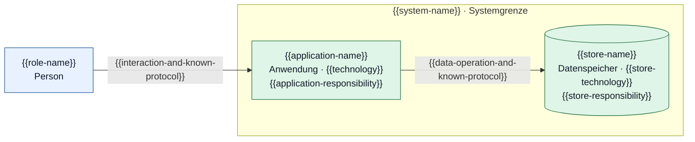

# C4 — Container: {{system-name}}

Scope und Stand: {{scope-and-existing-or-planned-state}}

Legende: Blau = Person; Grün = Anwendung oder Datenspeicher innerhalb der Systemgrenze. Pfeile zeigen Zweck und bekannten Kommunikationsmechanismus.

| Element-ID | Verantwortung | Technologie / Entscheidungsstand | Anforderungen / ADR |
|---|---|---|---|
| `application` | {{responsibility}} | {{known-technology-or-open}} | {{references}} |

## Offene Punkte

{{open-questions-or-none}}

Beim Verwenden die Platzhalter ersetzen. Die Vorlage fordert keinen Datenspeicher: nur durch aktuellen Kontext belegte Container übernehmen. Der Systemname muss mit L1 übereinstimmen.
