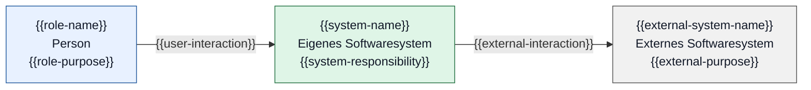

# C4 — Systemkontext: {{system-name}}

Scope und Stand: {{scope-and-existing-or-planned-state}}

Legende: Blau = Person; Grün = eigenes System; Grau = externes System. Pfeile zeigen eine gerichtete Beziehung mit ihrem Zweck.

| Element-ID | Name | Verantwortung | Anforderungen / Kontext |
|---|---|---|---|
| `system` | {{system-name}} | {{responsibility}} | {{source}} |

## Offene Punkte

{{open-questions-or-none}}

Beim Verwenden die Platzhalter ersetzen. Ein externes System oder eine Rolle nur übernehmen, wenn sie im aktuellen Scope tatsächlich vorhanden oder ausdrücklich geplant sind. Sonst die betreffenden Knoten und Beziehungen entfernen.
