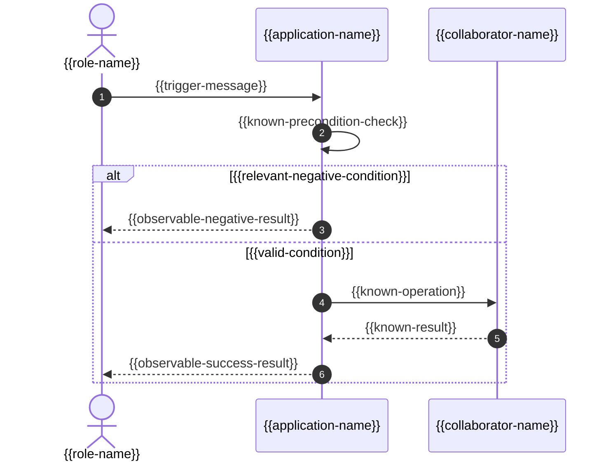

# Ablauf: {{scenario-title}}

- Story / Kriterien: {{story-and-criterion-ids}}
- Architekturstand / Teilnehmer: {{architecture-reference}}
- Vorbedingungen: {{preconditions}}
- Auslöser: {{trigger}}

## Ergebnisse und geplante Verifikation

| Kriterium / Pfad | Beobachtbares Ergebnis | Geplante Verifikation |
|---|---|---|
| {{criterion-id}} | {{expected-result}} | {{verification-plan}} |

## Offene Entscheidungen

{{open-decisions-or-none}}

Beim Verwenden die Platzhalter ersetzen. Teilnehmer und Alternativen nur aus dem tatsächlichen Szenario übernehmen. Bei relevanten Teilfehlern die bestätigte Fehlersemantik ergänzen; die Notationsvorlage legt kein konkretes Protokoll fest.
